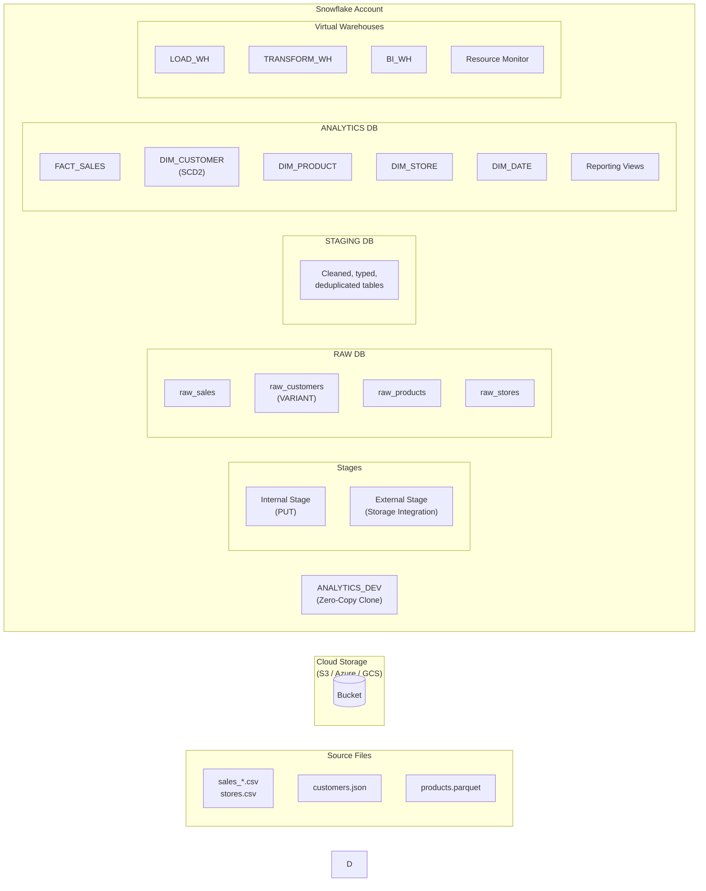

# Lab 1: Retail Sales Analytics Foundation

> **Level:** Beginner · **Theme:** Core platform fundamentals · **Frontend:** Snowsight dashboard

## Scenario

**Northwind Retail**, a fictional mid-size UK retailer with around 40 stores, runs its reporting from daily CSV exports emailed between teams and stitched together in spreadsheets. Numbers rarely agree, nobody knows which file is the latest, and the finance team waits until Wednesday for Monday's figures.

You have been hired to build the first version of a governed analytics platform on Snowflake. Your job is to land the raw files, model them properly, lock down access, and give the business a dashboard it can trust.

---

## Deliverables & Outcomes

By the end of this lab you will have:

- [ ] A Snowflake account structure with separate **RAW**, **STAGING** and **ANALYTICS** layers
- [ ] Sales, customer, product and store data loaded from **CSV, JSON and Parquet** files
- [ ] Data loaded from both an **internal stage** and an **external cloud storage stage**
- [ ] A **star schema** containing `FACT_SALES` and dimensions for customer, product, store and date
- [ ] A **Type 2 slowly changing dimension** on `DIM_CUSTOMER`
- [ ] A **custom role hierarchy** following least privilege (`LOADER`, `TRANSFORMER`, `ANALYST`)
- [ ] Right-sized **warehouses** with auto-suspend and a **resource monitor**
- [ ] A **dev environment** created with zero-copy cloning
- [ ] A demonstrated recovery using **Time Travel** and `UNDROP`
- [ ] A **Snowsight dashboard** with revenue, top products and store performance
- [ ] A **cost and performance report** comparing warehouse sizes
- [ ] Setup and teardown SQL scripts in `sql/`

### Skills You Can Demonstrate Afterwards

- Explaining Snowflake's architecture (storage, compute, cloud services) to a customer
- Designing a dimensional model and justifying it
- Designing RBAC that a security team would approve
- Reasoning about credit consumption and warehouse sizing

---

## Topics & Technology

| Category            | Topics                                                                                                                                                                   |
| ------------------- | ------------------------------------------------------------------------------------------------------------------------------------------------------------------------ |
| **Architecture**    | Storage/compute separation, cloud services layer, micro-partitions, result / warehouse / metadata caches                                                                 |
| **Compute**         | Virtual warehouses, sizing, auto-suspend/resume, resource monitors, `WAREHOUSE_METERING_HISTORY`                                                                         |
| **Objects**         | Databases, schemas, tables (permanent, transient, temporary), views                                                                                                      |
| **Ingestion**       | Internal & external stages, storage integrations, file formats, `PUT`, `COPY INTO`, `VALIDATION_MODE`, `ON_ERROR`, `INFER_SCHEMA`, `MATCH_BY_COLUMN_NAME`, load metadata |
| **Semi-structured** | `VARIANT`, dot and bracket notation, `FLATTEN`, `LATERAL`, casting                                                                                                       |
| **Modelling**       | Kimball star schema, surrogate keys, date dimension, SCD Type 2 with `MERGE`                                                                                             |
| **Security**        | System roles, custom roles, role hierarchy, privileges, future grants, ownership                                                                                         |
| **Data protection** | Time Travel, `AT` / `BEFORE`, `UNDROP`, Fail-safe, data retention                                                                                                        |
| **Environments**    | Zero-copy cloning                                                                                                                                                        |
| **Consumption**     | Snowsight worksheets, charts, dashboards                                                                                                                                 |
| **Tools**           | Snowsight, Snowflake CLI (`snow`), Git                                                                                                                                   |

---

## Step-by-Step Guide

> This lab is **self-directed**. Each step tells you _what_ to achieve and _what to research_, not exactly how to do it. Use the Snowflake documentation, Quickstarts and experimentation. Each step ends with a **"Done when"** check so you can verify your work.

### Step 0: Prepare Your Environment

**Goal:** Get a working account and tooling.

- Sign up for a Snowflake trial (Enterprise edition, on the cloud and region of your choice).
- Install and configure the Snowflake CLI, and create a named connection.
- Create a Git repo for this lab with `sql/`, `data/` and `docs/` folders.

**Research:** Snowflake editions, account identifiers, Snowflake CLI connection config, key-pair authentication.
**Done when:** `snow sql -q "SELECT CURRENT_ACCOUNT()"` works from your terminal.

---

### Step 1: Understand the Architecture

**Goal:** Be able to explain Snowflake's architecture before you build on it.

- Read about the three layers: storage, compute and cloud services.
- Learn what a micro-partition is and why Snowflake does not use indexes.
- Learn the three caches and when each one is used.

**Research:** Snowflake key concepts and architecture, micro-partitions and data clustering, query caching.
**Done when:** You can draw the architecture on a whiteboard and explain it in five minutes. Add your diagram to `docs/`.

---

### Step 2: Generate the Source Data

**Goal:** Create realistic messy source files.

- Generate synthetic data with Python (e.g. Faker) or derive it from the `SNOWFLAKE_SAMPLE_DATA` TPC-H tables:
  - `sales_YYYYMMDD.csv`: daily transactions (several days' worth)
  - `customers.json`: nested customer records (addresses as arrays, preferences as objects)
  - `products.parquet`: the product catalogue
  - `stores.csv`: store reference data
- **Deliberately add problems:** bad dates, missing values, duplicate rows and a malformed row or two.
- Produce a second version of `customers.json` in which some customers have changed address. You'll need it for SCD2.

**Research:** Faker, pandas / pyarrow to write Parquet, TPC-H schema.
**Done when:** You have at least 100k sales rows spread across multiple files, in all three formats.

---

### Step 3: Design the Account Structure & Compute

**Goal:** Lay out databases, schemas and warehouses with intent.

- Create the `RAW`, `STAGING` and `ANALYTICS` databases (or schemas), and write down why you chose one approach over the other.
- Create separate warehouses for loading, transformation and BI. Decide sizes and auto-suspend values, and document your reasoning.
- Create a resource monitor with notify and suspend thresholds.

**Research:** Warehouse sizes and credit consumption, auto-suspend best practices, resource monitors, transient vs permanent tables (and the effect on Fail-safe costs).
**Done when:** `SHOW WAREHOUSES` shows three warehouses with auto-suspend configured, and a resource monitor is attached.

---

### Step 4: Build the Role Hierarchy

**Goal:** Implement least-privilege RBAC _before_ loading data.

- Design roles: `LOADER` (writes to RAW), `TRANSFORMER` (reads RAW, writes STAGING and ANALYTICS), `ANALYST` (reads ANALYTICS only), and a `PLATFORM_ADMIN`.
- Roll the custom roles up to `SYSADMIN` and understand why that matters.
- Use future grants so new tables inherit permissions.
- Create a test user for each role.

**Research:** Access control overview, system-defined roles, role hierarchy and inheritance, future grants, "access roles vs functional roles", why you shouldn't build with `ACCOUNTADMIN`.
**Done when:** Logged in as `ANALYST`, you get a permission error querying RAW. Draw the hierarchy diagram into `docs/`.

---

### Step 5: Load Data from an Internal Stage

**Goal:** Land the CSV files.

- Create a named file format for the CSVs.
- Create an internal stage and upload the files with `PUT` (via the CLI).
- Use `COPY INTO` with `VALIDATION_MODE` first to see the errors, then load with an `ON_ERROR` strategy of your choice.
- Query the load history to see which files loaded and which rows were rejected.
- Re-run `COPY INTO` and observe what happens. Find out why the files aren't loaded twice.

**Research:** Stages (user, table, named), `PUT`, `COPY INTO <table>`, file formats, load metadata (64-day retention), `COPY_HISTORY`, `VALIDATE`.
**Done when:** Raw sales are loaded, rejected rows are captured or explained, and re-runs are idempotent.

---

### Step 6: Load Data from an External Stage

**Goal:** Load directly from cloud storage, the way an enterprise would.

- Upload the JSON and Parquet files to S3, Azure Blob or GCS.
- Create a **storage integration** (not embedded credentials) and an external stage.
- Use `INFER_SCHEMA` to generate the Parquet table definition, then load with `MATCH_BY_COLUMN_NAME`.
- Load the JSON into a `VARIANT` column.

**Research:** Storage integrations and the cloud IAM trust set-up, external stages, `INFER_SCHEMA`, `USING TEMPLATE`, why storage integrations beat access keys.
**Done when:** Products and customers are in RAW, loaded via an integration with no secrets stored in SQL.

---

### Step 7: Work with Semi-Structured Data

**Goal:** Turn nested JSON into relational tables.

- Query the customer `VARIANT` with dot and bracket notation.
- Use `LATERAL FLATTEN` to explode address arrays.
- Cast values to proper types and build clean STAGING tables.
- Clean the sales data: deduplicate, fix dates and handle nulls.

**Research:** Querying semi-structured data, `FLATTEN`, `TRY_CAST` / `TRY_TO_DATE`, `QUALIFY` with `ROW_NUMBER()` for deduplication.
**Done when:** STAGING contains clean, typed and deduplicated tables with no `VARIANT` columns.

---

### Step 8: Build the Star Schema

**Goal:** Model the data for analytics.

- Design the star schema on paper first: grain of the fact, dimensions, surrogate keys.
- Build `DIM_DATE` by generating rows (no source file).
- Build `DIM_PRODUCT`, `DIM_STORE` and `DIM_CUSTOMER`, then `FACT_SALES` with surrogate-key lookups.
- Implement **SCD Type 2** on `DIM_CUSTOMER` using `MERGE` with your second customers file (effective dates and a current flag).

**Research:** Kimball dimensional modelling, fact grain, surrogate keys (sequences vs hashes), `GENERATOR` and `SEQ4()`, `MERGE`, SCD Types 1, 2 and 3.
**Done when:** A customer who moved has two rows in `DIM_CUSTOMER`, and historic sales join to the _old_ address. Add an ERD to `docs/`.

---

### Step 9: Protect & Clone

**Goal:** Prove you can recover from mistakes and spin up environments for free.

- Clone the `ANALYTICS` database to `ANALYTICS_DEV`. Check the storage used, then change some data in the clone.
- "Accidentally" `DELETE` rows from `FACT_SALES`, then recover them with Time Travel (`AT` / `BEFORE` with a query ID).
- `DROP` a table and `UNDROP` it.
- Set different retention periods on different objects and explain the cost trade-off.

**Research:** Zero-copy cloning (what is and isn't cloned, including grants), Time Travel, `DATA_RETENTION_TIME_IN_DAYS`, Fail-safe, storage costs of clones over time.
**Done when:** You have documented a delete-and-recover run and a clone that used near-zero additional storage at creation.

---

### Step 10: Performance & Cost Experiments

**Goal:** Understand how Snowflake behaves under load and what it costs.

- Run the same heavy analytical query on XS, S and M warehouses, and record runtime and credits.
- Run it twice and observe the result cache. Disable the cache (`USE_CACHED_RESULT`) and compare.
- Open the **Query Profile** and identify the most expensive operator and how much partition pruning happened.
- Query `WAREHOUSE_METERING_HISTORY` and `QUERY_HISTORY` to build a cost table.

**Research:** Query Profile, partition pruning, result caching, scaling up vs scaling out, `ACCOUNT_USAGE` vs `INFORMATION_SCHEMA` (and the latency difference).
**Done when:** You have a chart of cost against runtime by warehouse size and can explain when to scale up.

---

### Step 11: Build the Dashboard

**Goal:** Give the business something it can use.

- As `ANALYST`, build Snowsight worksheets for total revenue, revenue by day, top 10 products, store league table and revenue by customer region.
- Combine them into a Snowsight dashboard with filters (date range, store).
- Optional: create reporting views in a dedicated schema so analysts never touch the base tables.

**Research:** Snowsight charts and dashboards, dashboard filters, secure vs standard views.
**Done when:** A working dashboard runs on the BI warehouse under the `ANALYST` role. Add screenshots to `docs/`.

---

### Step 12: Automate & Tear Down

**Goal:** Make the lab reproducible.

- Consolidate everything into ordered scripts (`sql/01_setup.sql` … `sql/99_teardown.sql`).
- Run them end to end from the Snowflake CLI on a clean account.
- Record the total credits the lab consumed.

**Research:** Snowflake CLI `snow sql -f`, idempotent DDL (`CREATE OR REPLACE`, `IF NOT EXISTS`, `CREATE OR ALTER`).
**Done when:** One command builds the whole lab, and one command removes it.

---

## End-State Architecture

